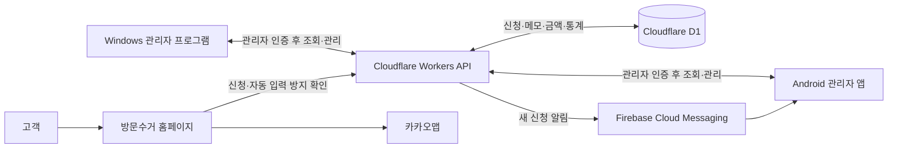

<div align="center">


# 헌옷일번지

**고객의 방문수거 신청부터 현장의 일정 관리, 운영 통계까지.**

홈페이지 · Android 관리자 앱 · Windows 관리자 프로그램을 연결한 방문수거 운영 프로젝트입니다.


[홈페이지](https://1beonji.com) · [네이버 블로그](https://blog.naver.com/sajin1366) · [네이버 카페](https://cafe.naver.com/sajin1366)

[주요 기능](#주요-기능) · [서비스 구조](#서비스-구조) · [설치와 업데이트](#설치와-업데이트) · [개발 시작하기](#개발-시작하기) · [문서](#문서)

</div>

---

## 프로젝트 소개

헌옷일번지는 헌옷과 생활용품의 방문수거를 안내하고 신청을 받는 서비스입니다. 고객은 모바일 홈페이지에서 수거를 신청하고, 관리자는 휴대폰과 PC에서 같은 서버의 신청 정보를 확인합니다.

신청 확인에 그치지 않고 **방문 일정, 신청서별 메모, 고객 표시, 하루 금액, 월별 통계**까지 실제 수거 업무에 필요한 기능을 함께 관리합니다.

| 고객을 위한 홈페이지 | 현장에서 쓰는 Android 앱 | 운영을 확인하는 Windows 프로그램 |
| :--- | :--- | :--- |
| 수거 품목과 제외 조건 안내 | 새 신청 알림과 처리 상태 관리 | 방문·전화 클릭·유입 통계 |
| 카카오맵 수거 지역 안내 | 달력·예약 시간·신청서 메모 | 홈페이지 접속·응답 상태 점검 |
| 희망 날짜·시간대·수거 방식 선택 | 전화·문자 작성·연락처 연동 | 신청 검색·편집·자료 내보내기 |

## 주요 기능

### 🌐 방문수거 홈페이지

- **모바일 중심 안내** — 실제 수거 사진, 품목별 카드와 상세 조건, 실루엣 아이콘으로 수거 가능 품목을 소개합니다.
- **온라인 신청** — 이름, 연락처, 주소, 수거량, 희망 날짜·시간대와 대면·비대면 수거 여부를 입력합니다.
- **입력 오류 안내** — 잘못된 항목에 안내를 표시하고, 희망 날짜는 내일부터 30일 이내의 월~토로 제한합니다.
- **수거 지역 지도** — 카카오맵에 지역별 도형을 표시하며, 별도 편집 화면에서 범위를 조정할 수 있습니다.
- **검색·광고 연결** — 검색엔진 확인 태그, Google Ads 신청 완료·전화 버튼 클릭 전환과 자체 유입 통계를 지원합니다.
- **접수 보호** — Cloudflare Turnstile 확인과 서버 검증을 거친 신청을 저장합니다.

### 📱 Android 관리자 앱

- **신청서 관리** — 목록·요약·상세 보기, 다중 상태 필터, 정렬, 직접 작성과 연락처 불러오기를 지원합니다.
- **방문 일정** — 날짜별 신청 건수, 예약 시간, 신청서 메모와 날짜별 메모를 확인합니다.
- **고객 응대** — 전화 걸기, 연락처 추가, 접수 안내 문자 작성, 전화번호별 단골·블랙리스트 표시를 제공합니다.
- **업무 기록** — 신청서에 연결된 메모를 모아 보고, 하루의 준 금액·받은 금액과 월별 통계를 관리합니다.
- **홈 화면 위젯** — 새 신청·연락 완료 신청을 희망 날짜순으로 표시하고 수거 방식·주소를 함께 확인합니다. 배경 투명도 설정과 엣지 패널 형태의 보조 화면도 지원합니다.
- **시세 확인** — 금·은·동·스텐·알루미늄의 공개 시세를 출처·단위·고시일과 함께 표시합니다.
- **앱 업데이트** — 새 버전을 확인하고 내려받은 뒤 Android 설치 화면으로 연결합니다.

> 문자 기능은 해당 번호의 메시지 작성 화면을 엽니다. 사용자가 내용을 확인하고 직접 전송하는 방식입니다. 위젯·잠금화면 표시는 기기와 시스템 설정에 따라 달라질 수 있습니다.

### 🖥️ Windows 관리자 프로그램

- **오늘의 현황** — 방문자, 조회수, 전화 버튼 클릭, 온라인 신청과 월별 그래프를 확인합니다.
- **유입 분석** — 구글·네이버 광고, 검색, 블로그·카페 등 경로별 통계를 비교합니다.
- **신청서별 유입 경로** — 새 온라인 신청에 전달된 경로를 목록과 상세 정보에 표시합니다. 이전 신청·정보가 없는 신청은 확인 불가, 관리자 작성은 직접 작성으로 구분합니다.
- **사이트 상태** — 홈페이지와 주요 신청 기능의 응답, 데이터베이스 연결 및 알림 설정을 점검합니다.
- **신청 업무** — 검색·상태 필터·정렬·직접 작성·수정·삭제와 예약 시간·메모 관리를 지원합니다.
- **업무 자료 조회** — 허용된 업무 표를 조회하고 CSV 또는 JSON으로 내보냅니다.
- **자동 업데이트** — 시작 시와 실행 중 매시간 새 버전을 확인·다운로드하며, 사용자 확인 후 설치하고 다시 실행합니다.

<p align="center">
  
  <br>
  <sub>Windows 관리자 프로그램 · 화면의 이름, 연락처와 신청 정보는 모두 예시 데이터입니다.</sub>
</p>

## 서비스 구조



현재 접수 방식은 **데이터베이스 저장 + Android 알림**입니다. SOLAPI 문자 접수 경로도 코드에 포함되어 있지만, 현재 관리자 앱 접수 방식에서는 필수 설정이 아닙니다.

### 기술 구성

| 영역 | 구성 |
| :--- | :--- |
| 웹·서버 | TypeScript, React, Next.js App Router 구조, vinext, Vite |
| 홈페이지 화면 | HTML, CSS, JavaScript |
| 실행 환경·저장소 | Cloudflare Workers, D1 |
| Android | Java 17, Android SDK 36, Firebase Cloud Messaging |
| Windows | C#, WPF, .NET Framework 4.8 |
| 외부 연결 | 카카오맵 JavaScript SDK, Turnstile, Google Ads 태그 |
| 검증 | Node.js 테스트, TypeScript 검사, Android 테스트, Windows 자체 검사 |

### 통계를 읽을 때

| 항목 | 집계 기준 |
| :--- | :--- |
| 방문자 | 브라우저의 일별 임의 식별자로 중복 방문을 구분한 수치 |
| 조회수 | 새로고침과 재방문을 포함한 페이지 조회 |
| 전화 클릭 | 홈페이지에서 전화번호를 누른 횟수. 실제 통화 연결 수와는 다름 |
| 온라인 신청 | 서버에서 접수 완료한 신청. 관리자 직접 작성은 제외 |
| 유입 경로 | 광고 식별자·UTM·방문 출처로 분류한 유형. 정보 차단 시 누락 가능 |

신청서에는 **유입 경로 유형만 저장**하며 전체 방문 URL·검색어·광고 클릭 식별자는 저장하지 않습니다. 자체 통계는 광고 플랫폼의 과금·전환 보고서와 일치하지 않을 수 있습니다.

## 설치와 업데이트

| 프로그램 | 배포 버전 | 설치 | 안내 |
| :--- | :--- | :--- | :--- |
| Android 관리자 | 1.4.19 | [APK 다운로드](https://1beonji.com/admin-app/heonot-admin-1.4.19.apk) | [앱 사용 안내](docs/관리자앱-1.4.19-사용안내.md) |
| Windows 관리자 | 1.0.2 | [설치 파일 다운로드](https://1beonji.com/desktop-app/HeonotDesk-Setup-1.0.2.exe) | [PC 설치·사용 안내](docs/PC관리자-설치와사용.md) |

배포 버전은 저장소의 [Android 업데이트 정보](public/admin-app/latest.json)와 [Windows 업데이트 정보](public/desktop-app/latest.json)를 기준으로 합니다. 신청 데이터 조회에는 관리자 로그인이 필요합니다.

Windows 1.0.0은 자동 업데이트 기능이 없으므로 최신 설치 파일을 한 번 직접 설치해야 합니다. 1.0.1부터는 프로그램 안에서 업데이트할 수 있습니다. Android 업데이트는 기존 앱과 **동일한 서명 키**로 배포해야 합니다.

## 저장소 구성

```text
HeonotIlbeonji/
├── app/                 # 홈페이지 응답, 관리자·신청·통계 API
├── lib/                 # 입력 검증, 인증, DB, 알림, 시세·통계 처리
├── public/
│   ├── html/            # 홈페이지 원본과 수거 지역 편집 화면
│   ├── css/             # 반응형 화면·모션 스타일
│   ├── js/              # 신청서, 지도, 통계·전환 추적
│   ├── images/          # 로고·수거 사진·아이콘
│   ├── data/            # 수거 지역 도형 설정
│   ├── admin-app/       # Android 설치 파일·업데이트 정보
│   └── desktop-app/     # Windows 설치 파일·업데이트 정보
├── android-admin/       # Android 관리자 앱
├── desktop-admin/       # Windows 관리자 프로그램·설치기
├── scripts/             # 초기 관리자 설정·배포 파일 준비
├── tests/               # 서버·브라우저 동작 회귀 검사
└── docs/                # 설치·운영·업데이트 안내
```

## 개발 시작하기

### 웹·API

**Node.js 24 LTS와 pnpm**을 권장합니다. `node:sqlite`를 사용하는 테스트가 있으므로 Node.js 24에서 검증하는 것이 편리합니다.

```sh
pnpm install --frozen-lockfile
```

[.env.example](.env.example)을 `.env.local`로 복사하고 개발 환경에 맞게 채웁니다.

```sh
pnpm dev
```

개발 주소는 `http://localhost:4174`입니다. 신청서 저장·로그인·알림에는 별도 서비스 설정이 필요하며, HTML 파일만 여는 정적 서버로는 API가 동작하지 않습니다.

<details>
<summary><strong>환경 설정 항목 보기</strong></summary>

| 항목 | 용도 |
| :--- | :--- |
| `PICKUP_DELIVERY_MODE` | 관리자 신청함 접수는 `dashboard` |
| `SITE_ORIGIN` | 허용할 홈페이지 원본 주소 |
| `ADMIN_PASSWORD`, `ADMIN_SESSION_SECRET` | 관리자 인증과 세션 서명 |
| `TURNSTILE_SITE_KEY`, `TURNSTILE_SECRET_KEY` | 온라인 신청 자동 입력 방지 |
| `FCM_SERVICE_ACCOUNT_JSON` | 서버의 Android 알림 발송 |
| `KAKAO_MAP_JAVASCRIPT_KEY` | 홈페이지 카카오맵 표시 |
| `PICKUP_D1_DATABASE_ID` | D1 데이터베이스 설정 |
| `PICKUP_SMS_ENABLED`, `PICKUP_SMS_TO`, `SOLAPI_*` | 선택 사항인 SOLAPI 문자 접수 설정 |

서버에는 `PICKUP_DB`라는 이름의 D1 바인딩이 필요합니다. 운영 환경의 비밀값은 호스팅 서비스의 Secret 설정에서 관리합니다. 로컬 환경 파일, Firebase 서비스 계정, Android 서명 키는 저장소에 올리지 않습니다.

Android Firebase 설정 파일은 `android-admin/app/google-services.json`에 별도로 준비합니다. Android 배포 빌드의 `apiBaseUrl`에는 실제 HTTPS 서버 주소를 지정합니다.

</details>

### 검사와 웹 빌드

```sh
node --test tests/*.test.mjs
pnpm exec tsc --noEmit
pnpm build
```

### Windows 빌드

Windows PowerShell에서 .NET Framework 4.8 참조 어셈블리와 C# 컴파일러를 준비한 뒤 실행합니다.

```powershell
powershell -NoProfile -ExecutionPolicy Bypass -File desktop-admin/build.ps1
node scripts/publish-desktop.mjs
```

자세한 빌드·미리보기·설치 검사는 [Windows 개발 안내](desktop-admin/README.md)를 참고하세요. Android 빌드·배포 순서는 [앱 업데이트 안내](docs/관리자앱-업데이트.md)에 정리되어 있습니다.

## 데이터와 운영

- 신청 정보는 관리자 인증을 거쳐 조회·관리합니다. Windows 로그인 유지 정보는 현재 사용자 전용 암호화 방식으로 저장합니다.
- 앱 알림에는 고객 신청 내용 대신 새 신청 알림을 보내며, 상세 정보는 인증된 API로 가져옵니다.
- CSV·JSON 내보내기는 업무 자료 보관용입니다. **D1 전체 백업이나 원클릭 복원 기능은 아니며**, 파일에는 고객 개인정보가 포함될 수 있습니다.
- 사이트 상태 점검은 프로그램 실행 중 수행합니다. 알림 설정이 정상이라는 표시가 실제 알림 수신 성공까지 보장하지는 않습니다.
- 수거 지역 도형은 상담용 예시 범위입니다. 실제 수거 가능 여부는 주소와 품목을 확인한 뒤 결정합니다.
- 공개 시세는 출처·품목·단위별 참고 가격이며 실제 수거 매입 금액을 보장하지 않습니다.

## 문서

| 문서 | 내용 |
| :--- | :--- |
| [PC 관리자 설치·사용](docs/PC관리자-설치와사용.md) | 설치, 자동 업데이트, 통계, 자료 내보내기 |
| [Windows 개발 안내](desktop-admin/README.md) | 빌드, 자체 검사, 예시 화면 렌더링 |
| [Android 업데이트 안내](docs/관리자앱-업데이트.md) | 버전·서명 관리와 APK 배포 |
| [Android 1.4.19 사용 안내](docs/관리자앱-1.4.19-사용안내.md) | 시세 화면과 출처·가격 기준 |
| [수거 지역 지도 수정](docs/service-area-map.md) | 카카오맵 설정과 지역 도형 편집 |
| [SOLAPI 문자 접수 안내](docs/pickup-sms.md) | 선택 사항인 문자 접수 연결 |

---

<div align="center">

**헌옷 팔 땐, 일번지.**

고객에게는 간편한 신청을, 관리자에게는 편리한 수거 업무를.

</div>
