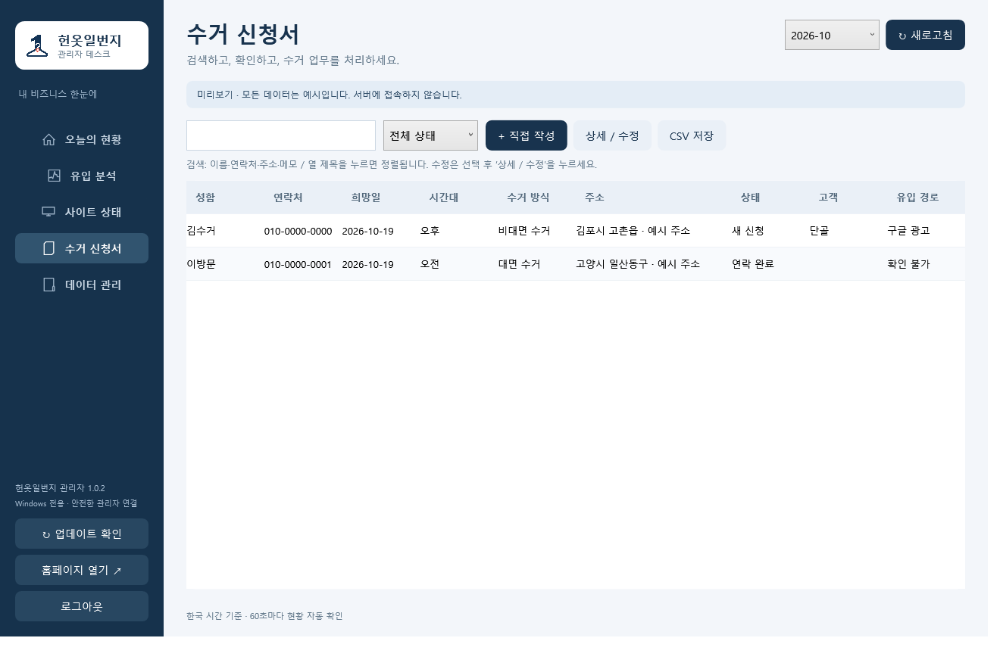

# 헌옷일번지

### 방문수거의 시작부터 마무리까지, 하나로 연결하다.

고객을 위한 홈페이지와 운영자를 위한 전용 앱·PC 프로그램을 함께 만든 프로젝트입니다.

[홈페이지 둘러보기](https://1beonji.com) · [네이버 블로그](https://blog.naver.com/sajin1366) · [네이버 카페](https://cafe.naver.com/sajin1366)

---

## 프로젝트 소개

**헌옷일번지**는 헌옷과 생활용품의 방문수거 서비스를 위한 프로젝트입니다.

고객이 수거 품목을 확인하고 신청하는 과정부터, 운영자가 방문 일정을 정하고 현장에서 수거 업무를 처리하는 과정까지 연결했습니다. 여러 곳에 흩어지기 쉬운 신청·일정·메모를 한 흐름으로 관리하는 데 초점을 맞췄습니다.

> Android 앱과 Windows 프로그램은 헌옷일번지 운영자를 위한 **전용 업무 도구**입니다. 이 README는 프로젝트를 소개하기 위한 페이지입니다.

## 세 가지 화면, 하나의 업무 흐름

| 🌐 고객용 홈페이지 | 📱 현장용 Android 앱 | 🖥️ 운영용 PC 프로그램 |
| :--- | :--- | :--- |
| 어떤 물건을 수거하는지 쉽게 확인 | 새 신청과 방문 일정을 빠르게 확인 | 운영 현황과 문의 흐름을 한눈에 확인 |
| 수거 지역을 지도로 안내 | 신청 내용과 현장 메모를 함께 관리 | 신청서 검색과 업무 기록 관리 |
| 모바일에서 간편하게 방문수거 신청 | 고객 응대와 수거 업무를 편리하게 처리 | 홈페이지 통계와 유입 경로 확인 |

## 고객에게는 간편하게

실제 수거 사진과 품목별 안내를 통해 서비스 내용을 쉽게 이해할 수 있도록 구성했습니다. 모바일에서도 필요한 정보를 찾고, 희망 날짜와 수거 방식을 선택해 신청할 수 있습니다.

- **사진과 아이콘으로 보는 수거 품목**
- **지도로 확인하는 수거 지역**
- **대면·비대면 방문수거 신청**
- **작은 화면에서도 읽기 편한 구성**

## 현장에서는 빠르게

Android 전용 앱은 이동과 고객 응대가 많은 수거 업무에 맞춰 구성했습니다. 신청 확인부터 일정 관리, 전화와 문자 작성까지 자주 사용하는 기능을 가까이 배치했습니다.

- **새 신청 알림과 간결한 신청 목록**
- **달력으로 확인하는 방문 일정**
- **신청서별 예약 시간과 업무 메모**
- **고객 응대, 위젯, 금액 기록과 시세 확인**

## 운영은 한눈에

PC에서는 넓은 화면을 활용해 신청서와 운영 정보를 확인할 수 있습니다. 홈페이지 방문과 문의가 어떤 흐름으로 이어지는지 살펴보고, 필요한 신청과 기록을 찾아 관리합니다.

- **오늘의 방문·문의 현황**
- **광고·검색 등 유입 경로 확인**
- **신청서 검색과 처리 상태 관리**
- **홈페이지 상태와 업무 통계 확인**

  
   
  PC 관리자 프로그램 미리보기 · 화면에는 실제 고객 정보가 아닌 예시 데이터를 사용했습니다.

## 이렇게 만들었습니다

**고객의 신청 편의와 운영자의 실제 사용성**을 함께 고려했습니다.

모바일 홈페이지는 핵심 정보를 중심으로 구성하고, 현장 앱은 빠른 확인과 입력에, PC 프로그램은 넓은 화면에서의 조회와 분석에 집중했습니다. 화면마다 역할을 나누면서도 같은 업무가 자연스럽게 이어지도록 설계했습니다.

**TypeScript · React · Java · C# · WPF · Cloudflare**

---

**헌옷 팔 땐, 일번지.**

고객에게는 간편한 신청을, 운영자에게는 편리한 수거 업무를.

